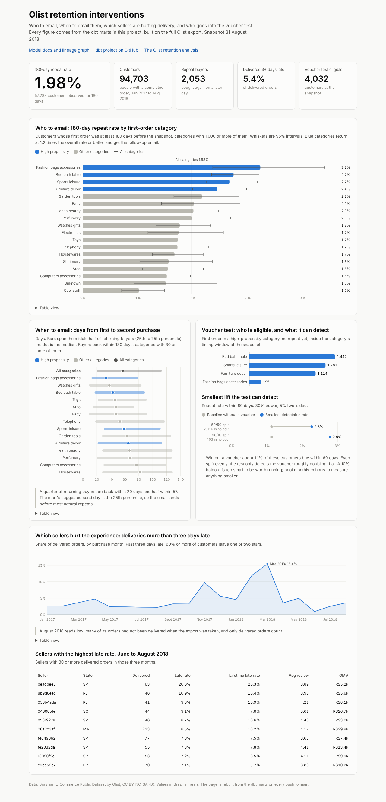
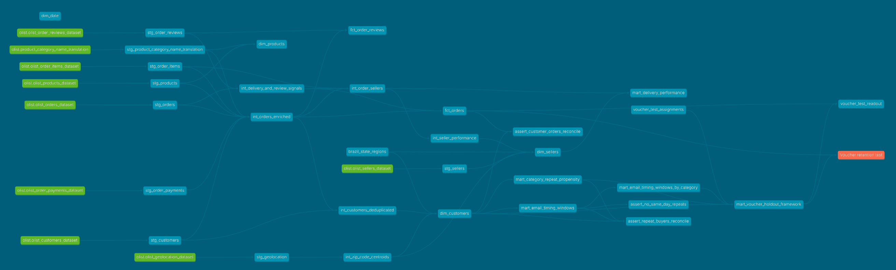

# Olist retention intervention analytics

A dbt project on BigQuery that turns the conclusions of the [Olist customer retention analysis](https://github.com/JoshuaPaul-lasisi/olist-customer-retention) into tables a marketing team can use: who to email, when to email them, which sellers are hurting the experience, and who goes into a voucher test.

Dashboard: [joshuapaul-lasisi.github.io/retention-intervention-analytics](https://joshuapaul-lasisi.github.io/retention-intervention-analytics/)

Model docs and lineage graph: [joshuapaul-lasisi.github.io/retention-intervention-analytics/docs](https://joshuapaul-lasisi.github.io/retention-intervention-analytics/docs/)

Both are rebuilt from the marts and published to GitHub Pages on every push to main.



## Where this comes from

The Olist analysis found that 97.8% of customers buy once, that only about 2% come back within 180 days, and that raising that to 3% would add about R$129,000 of GMV a year. Retention spend therefore has to be cheap: follow-up email, timing and category targeting, with any voucher tested against a hold-out group before rollout.

That analysis lives in notebooks. This project rebuilds the same logic as tested, documented dbt models so the targeting and the test can run every month without anyone opening a notebook.

## What the marts say

Built on the full Olist export, snapshot 31 August 2018.

1. 96,096 people sit behind 99,441 order-scoped customer IDs. 94,703 have a qualifying order (completed, January 2017 to August 2018) and 2,053 of them bought again on a later day.
2. 57,283 people first bought at least 180 days before the snapshot; 1.98% of them came back within 180 days. These match the Olist analysis exactly.
3. Four categories return at least 1.2 times the overall rate and are flagged high-propensity: fashion bags and accessories (3.2%), bed, bath and table (2.7%), sports and leisure (2.7%) and furniture and decor (2.4%). Cool stuff, the gadget category, sits at 1.0%.
4. Half of all returning buyers are back within 57 days and a quarter within 20. Bed, bath and table buyers return sooner (median 43 days); furniture and decor buyers later (65 days).
5. 5.4% of delivered orders arrive more than three days late, the point where bad reviews take off.
6. 4,032 customers are eligible for the voucher test at the snapshot. Their baseline chance of buying within 60 days is about 1.1%.

## Architecture

```
models/
  staging/       one model per raw table: rename, cast, nothing else
  intermediate/  business rules, joins, deduplication
  core/          star schema: dimensions and facts
  analytics/     marts for each intervention, and the voucher test exposure
seeds/           Brazil state regions; voucher test assignments
site/            the dashboard page; CI adds its data and the dbt docs before publishing
macros/          BigQuery and DuckDB differences; category translation; a row count test
analyses/        voucher test readout
tests/           reconciliation tests across layers
scripts/         data download, BigQuery load, holdout assignment, dashboard data export
docs/images/     dashboard and lineage screenshots
```

The lineage graph, from the raw Olist tables on the left to the voucher test exposure on the right. The interactive version is on the [docs site](https://joshuapaul-lasisi.github.io/retention-intervention-analytics/docs/#!/overview?g_v=1).



### Staging (9 models)

One model per Olist table: `stg_orders`, `stg_order_items`, `stg_order_payments`, `stg_order_reviews`, `stg_customers`, `stg_sellers`, `stg_products`, `stg_product_category_name_translation` and `stg_geolocation`. Each renames to snake_case, casts types, pads zip prefixes back to five digits and fixes the source's "lenght" spelling. Nothing else.

`stg_customers.yml` documents the main data quality issue in the source: `customer_id` is issued per order, so it is not a person. `customer_unique_id` is the person, and every person-level model downstream uses it as the grain. Counting `customer_id` makes the repeat rate look like zero.

### Intermediate (6 models)

1. `int_orders_enriched`: one row per order. Joins items, payments and products; attaches the English category of the lead (most expensive) item, the main payment method, item count and order value. Flags `is_completed` and `is_in_analysis_window`.
2. `int_customers_deduplicated`: one row per person. Collapses every `customer_id` onto `customer_unique_id` and rebuilds first order, second purchase, last order, order count, spend and `is_repeat_buyer`. This is where the deduplication lives.
3. `int_delivery_and_review_signals`: one row per order. Delivery delta (actual minus estimated, days), on-time and late flags, the latest review score and review response time.
4. `int_seller_performance`: one row per seller. Average delivery delta, average review score, late delivery rate, GMV and order count.
5. `int_order_sellers`: one row per order and seller. About 1% of orders hold items from more than one seller, so seller metrics need this grain. Both `int_seller_performance` and `mart_delivery_performance` read from it, which keeps the two consistent.
6. `int_zip_code_centroids`: one row per zip prefix. The raw geolocation table has about a million points for 19,000 prefixes; this collapses them so customers and sellers get a latitude and longitude.

The last two were not in the original plan. Without them the seller logic would be written twice and the geolocation table would have no use.

### Core (star schema)

Dimensions: `dim_customers` (one row per person, with region from the seed), `dim_products`, `dim_sellers` and `dim_date` (a date spine from BigQuery's `generate_date_array`).

Facts: `fct_orders` (one row per order, every order in the source, clustered by customer and purchase date on BigQuery) and `fct_order_reviews` (one row per review and order pair, with response time and a sentiment flag; 1 and 2 stars are negative).

`fct_orders` carries the lead item's seller and product as its foreign keys. `dim_customers` keeps people with no qualifying order (flagged) so that every order has a customer.

### Analytics

| Mart | Grain | Question it answers |
|---|---|---|
| `mart_category_repeat_propensity` | first-order category | Which first purchases are worth a follow-up email? |
| `mart_email_timing_windows` | repeat buyer | How long did each returning buyer take? |
| `mart_email_timing_windows_by_category` | first-order category | When should the email go out? |
| `mart_delivery_performance` | seller and month | Which sellers are degrading the experience? |
| `mart_voucher_holdout_framework` | eligible customer | Who goes into the voucher test? |

## Business rules

These carry over from the Olist analysis so the numbers match.

1. A person is `customer_unique_id`.
2. A qualifying order is completed (has items, not canceled or unavailable) and purchased from 1 January 2017 to 31 August 2018. September to December 2016 is a handful of test orders; the export stops partway through September 2018.
3. Order value is item prices plus freight. The lead item, the most expensive one, sets the order's category, product and seller.
4. A repeat purchase is a qualifying order on a later calendar day than the first. A same-day second order is a split cart, about a third of apparent second orders.
5. The 180-day repeat rate only counts people whose first order was at least 180 days before the snapshot, so recent buyers who have not had time to return do not drag it down. The same cut applies to the timing windows, so recent cohorts, which can only show short gaps, do not pull the windows forward.
6. A delivery is late when it arrives more than three days after the estimate.

Every threshold is a var in `dbt_project.yml`: the window dates, the 180 and 60-day windows, the late threshold, the minimum category size (1,000 buyers), the high-propensity lift (1.2) and the voucher eligibility start (14 days).

## The voucher test

`mart_voucher_holdout_framework` produces the eligible population, not the assignment. A customer is eligible when the first order was in a high-propensity category, they have not bought again, and they are inside the category's timing window: at least 14 days since the first order (the parcel has arrived) and no later than the category's 75th percentile of days to repeat.

Assignment happens outside dbt:

1. Export the mart to CSV.
2. Run `scripts/assign_holdout.py`. It splits customers 50/50 within each category by a salted SHA-256 hash, so the split is reproducible, nobody chooses who lands where and the category mix matches. It writes `seeds/voucher_test_assignments.csv`, which ships empty.
3. Run `dbt seed` and rebuild the mart; `assigned_group` fills in.
4. After 60 days, compile and run `analyses/voucher_test_readout.sql`. It gives the repeat rate in each group, the difference and a 95% interval.

The `voucher_test` exposure in `models/analytics/exposure_voucher_test.yml` documents the grain, the assignment, the metric and the expected group sizes.

The sizing is the weak point and I'd rather say so here. With 4,032 eligible people and a 1.1% baseline, a 50/50 split gives about 2,016 per group, and that only detects a rise to about 2.3% (80% power, 5% significance). In other words, the test can only tell you whether the voucher doubles repeat buying. A conventional 10% holdout of 403 people could not detect anything under 2.8%. To measure a smaller effect, pool several monthly cohorts or widen eligibility to the next categories down. The script prints this check every time it runs.

## Tests

110 data tests, all passing on the full dataset, plus one deliberate warning.

1. `customer_unique_id` in `dim_customers`: unique and not null.
2. `fct_orders`: unique `order_id`; not null and relationship tests on every foreign key (customer, seller, product, date). Seller and product are only required when the order has items; 775 orders have none, almost all canceled or unavailable.
3. `delivery_delta_days` in `int_delivery_and_review_signals`: no delivery more than 60 days early. The raw data has 34 such orders, so the test warns on them and fails only above 100.
4. `repeat_rate` in `mart_category_repeat_propensity`: between 0 and 1.
5. `stg_customers` against the raw table: `dbt_utils.equal_rowcount`, plus a `row_count_in_band` test (95,000 to 105,000 rows). The band catches a truncated or doubled load, which an equal-count test would miss because both sides would be wrong together.
6. Reconciliation tests in `tests/`: lifetime orders on `dim_customers` add up to qualifying orders in `fct_orders`; repeat buyers agree across `dim_customers`, the propensity mart and the timing mart; and no same-day order reaches the timing mart.
7. Accepted values on order status, payment type, review score, region, sentiment and assigned group; uniqueness on every mart's grain.

## How to run

You need Python 3.10 or later. `requirements.txt` pins exact versions (dbt-core 1.12.6, dbt-bigquery 1.12.1, dbt-duckdb 1.11.1, dbt_utils 1.3.0) and `dbt_project.yml` refuses to run on any other dbt-core version, so a build here and a build in CI use the same code.

```bash
pip install -r requirements.txt
```

```bash
./scripts/download_olist_data.sh
```

The download script pulls the nine CSVs from Olist's own GitHub copy into `data/raw/`, so no Kaggle login is needed. The Kaggle copy (olistbr/brazilian-ecommerce) is the same data.

### On BigQuery

The project has been built on BigQuery (project `customer-retention-513409`, free sandbox tier): 137 checks pass with the same one warning, and every mart matches the DuckDB build to the cent.

```bash
gcloud auth application-default login
```

```bash
GCP_PROJECT=your-project ./scripts/load_raw_to_bigquery.sh
```

```bash
export DBT_PROFILES_DIR=$PWD GCP_PROJECT=your-project
```

```bash
dbt deps && dbt build
```

This creates the datasets `olist_staging`, `olist_intermediate`, `olist_core`, `olist_analytics` and `olist_seeds`. The raw tables go to `olist_raw`. Set `BIGQUERY_LOCATION` if you don't want the US multi-region, and `BIGQUERY_AUTH_METHOD=service-account` with `BIGQUERY_KEYFILE` to use a service account file.

Two things the BigQuery run caught that DuckDB did not:

1. Schema detection names the columns of an all-text CSV `string_field_0` and `string_field_1`, so the load script gives the category translation table its schema explicitly.
2. The sandbox tier drops any table partition older than 60 days as it is written. A `fct_orders` partitioned by purchase month came out empty, so it is clustered instead; at 100,000 rows partitioning gains nothing anyway. The sandbox also expires tables after 60 days, so rerun `dbt build` to bring them back, or turn on billing to keep them.

### Locally on DuckDB

The models use dbt's cross-database macros and a few dispatched helpers in `macros/cross_db.sql`, so the same project runs on DuckDB straight from the CSVs, with no cloud account.

```bash
export DBT_PROFILES_DIR=$PWD DBT_TARGET=duckdb
```

```bash
dbt deps && dbt build
```

GitHub Actions runs exactly this on every push and pull request (`.github/workflows/dbt_build.yml`).

```bash
dbt docs generate && dbt docs serve
```

The docs site shows every model and column description and the lineage graph from raw tables to the exposure.

### The dashboard

`site/index.html` is one static page: plain HTML and SVG, no libraries. It reads `site/data.json`, which `scripts/export_dashboard_data.py` writes from the DuckDB build. To see it locally after `dbt build`:

```bash
python scripts/export_dashboard_data.py && python -m http.server -d site 8000
```

It has four parts, one per mart: repeat rate by first category with 95% intervals (who to email), days to second purchase by category (when to email), the monthly late delivery rate with the worst recent sellers, and the voucher test population with the smallest lift each split can detect. Every chart has a table view.

## Limits

1. The data ends in August 2018, so the marts are a snapshot as of 31 August 2018. In production the snapshot date would be the run date and the eligible pool would refresh daily.
2. No voucher test was run. The readout was checked end to end with a dummy assignment; it returns zero returns because the export holds almost no orders after the snapshot.
3. The high-propensity cut (1.2 times the overall rate) is a judgement call. The Wilson intervals in the propensity mart show that the gap between, say, furniture and garden tools is within noise.
4. Value is GMV. Olist's margins are not public, so the mart cannot say whether a voucher pays for itself.

## Tools

dbt Core 1.12.6, BigQuery, DuckDB for local runs and CI, dbt_utils 1.3.0, Python for the assignment and export scripts, plain HTML and SVG for the dashboard, GitHub Actions and GitHub Pages.

## Licence

The Olist data and anything derived from it stay under CC BY-NC-SA 4.0 with attribution to Olist. The raw files are not stored in this repository.

## Contact

GitHub: [JoshuaPaul-lasisi](https://github.com/JoshuaPaul-lasisi)
